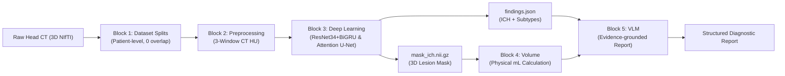

# Context & System Architecture

## System Overview
- **Project Name:** A VLM-Based System for Intracranial Hemorrhage Assessment on Brain CT
- **Tech Stack:** Python 3.10+, PyTorch (GPU CUDA / Tesla T4), torchvision, segmentation-models-pytorch (SMP), nibabel, scikit-learn, jsonschema.
- **Hardware Targets:** Google Colab (Tesla T4 16GB VRAM) for training; local workstation for verification/testing.
- **Interface Contract:** Standardized JSON/NIfTI contracts across all blocks (`docs/INTERFACE_CONTRACT.md` v1.0).
- **Primary Block 3 Deliverables:**
  - `findings.json` (ICH presence, 5 subtype probabilities, side localization, schema-validated).
  - `mask_ich.nii.gz` (3D binary hemorrhage segmentation mask in original physical geometry $512 \times 512 \times Z$).

## Architecture & Data Flow

## Module Boundaries
- **Block 1 (`blocks/block-01-dataset-split/`):** Patient-level train/val/test splits (134/28/30 on BHSD 192).
- **Block 2 (`blocks/block-02-preprocessing/`):** Multi-window HU extraction (Brain W80/L40, Subdural W200/L80, Bone W2800/L600).
- **Block 3 (`blocks/block-03-deep-learning/`):**
  - Multi-label Classification: ResNet-34 + Bi-directional GRU across Z-slices (SeuTao RSNA 1st Place).
  - 3D Lesion Segmentation: scSE Attention U-Net + Focal Tversky Loss (MICCAI INSTANCE 2022 Champion).
- **Block 4 (`blocks/block-04-volume/`):** Computes physical volume in mL via `voxel_count * dx * dy * dz / 1000`.
- **Block 5 (`blocks/block-05-vlm/`):** Generates Vietnamese structured medical report strictly grounded on evidence pointers.

## Tech Debt & Critical Invariants
1. **Physical Spatial Resolution:** Input CT images are $512 \times 512$. Must preserve native resolution to capture sub-millimeter sulcal SAH bleeds. Avoid silent downsampling to 256.
2. **Pure End-to-End AI:** Avoid hardcoded heuristic post-processing (e.g. `hu >= 15 & hu <= 105` or `min_size < 15px`). AI must learn bone/tissue separation via Bone Window and Attention gates.
3. **Strict Interface Compliance:** All output files must pass `validate_output.py` against `findings.schema.json`.
